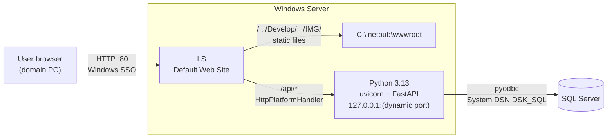

# Data Swiss Knife – Architecture

Internal tools portal running on **IIS** in an air-gapped Windows environment.
IIS serves every page the user sees; **Python (FastAPI)** is used only as a backend that returns data (JSON or files) and never HTML.

---

## 1. Overview



| Layer | Technology | Responsibility |
|---|---|---|
| Web server | IIS 10, HTTP only (port 80) | Serves the frontend, authenticates users, routes `/api` to Python |
| Authentication | Windows Authentication (SSO) | Users are identified silently as `DOMAIN\username` |
| Authorization | IIS URL Authorization | Restricts folders/pages to AD security groups |
| Frontend | Static HTML + JS + JSON config | Portal pages; content driven by JSON files |
| Backend | Python 3.13, FastAPI, uvicorn | Data endpoints under `/api/...` (JSON / files only) |
| Process hosting | HttpPlatformHandler v1.2 | IIS starts, monitors and restarts the Python process |
| Database | SQL Server via ODBC | Accessed with a SQL login through System DSN `DSK_SQL` |

Key principles:

- **One entry point.** Users only talk to IIS on port 80. Python listens on `127.0.0.1` only and is never reachable from the network, so no extra firewall ports are opened.
- **Same origin.** Pages call the backend with relative URLs (`fetch('/api/...')`), so there is no CORS and no hard-coded host names or ports.
- **Configuration over code.** Portal tiles and links are edited in JSON files; no HTML change is needed.
- **Air-gap friendly.** No page loads anything from the internet: icons, images and fonts are local, and FastAPI's online `/docs` page is disabled.

---

## 2. Server layout

```
C:\inetpub\wwwroot\                 ← IIS site root (frontend only)
│   index.html                      ← main portal page (tiles)
│   tiles.json                      ← main page configuration
│
├── IMG\                            ← shared images for all pages
│       favicon.svg                 ← browser tab icon
│       favicon.ico                 ← tab icon fallback
│       *.png / *.svg               ← tile and link icons
│
└── Develop\                        ← development landing page
        Devidx.html                 ← page
        Devidx.json                 ← page configuration
        web.config                  ← default document = Devidx.html

C:\Apps\dsk-api\                    ← Python backend (outside wwwroot on purpose)
│   main.py                         ← FastAPI application
│   web.config                      ← HttpPlatformHandler configuration
└── logs\                           ← Python stdout / error logs
```

The backend lives outside `wwwroot` so Python source and configuration can never be downloaded through the website.

---

## 3. IIS configuration

### Installed role services

| Area | Feature | Why |
|---|---|---|
| Common HTTP | Default Document, Static Content, HTTP Errors | Serve pages and assets |
| Security | Request Filtering | Default protection (blocks `web.config`, oversized requests, etc.) |
| Security | Windows Authentication | SSO for domain users |
| Security | URL Authorization | AD group-based access rules |
| Application Development | ASP.NET 4.x, ISAPI, CGI | Available for server-side handlers |
| Management | IIS Management Console | `inetmgr` |
| Add-on | HttpPlatformHandler v1.2 (x64) | Hosts the Python backend |

### Site: Default Web Site

| Setting | Value |
|---|---|
| Binding | `http *:80` (no HTTPS) |
| Anonymous Authentication | **Disabled** |
| Windows Authentication | **Enabled**, providers: Negotiate, NTLM |
| Default document | `index.html` (root), `Devidx.html` (`/Develop`) |

Users get silent sign-in when the site is in the browser's **Local Intranet** zone (automatic for short host names; FQDN/alias via GPO *Site to Zone Assignment List*).

### Application: `/api`

| Setting | Value |
|---|---|
| Type | IIS Application under Default Web Site |
| Physical path | `C:\Apps\dsk-api` |
| Application pool | `dsk-api` – **No Managed Code** |
| Folder permissions | `IIS APPPOOL\dsk-api`: Read/Execute on `C:\Apps\dsk-api`, Modify on `logs\` |
| Authentication | Inherited from the site (Windows SSO) |

### Authorization by AD groups

Access is controlled per folder with **Authorization Rules** (URL Authorization): remove *Allow All Users* and add *Allow* for specific AD security groups. Example structure:

```
wwwroot\            → all authenticated users
wwwroot\Develop\    → e.g. DOMAIN\DSK_Developers only
```

Notes:
- Use AD **security** groups; nested groups are supported.
- Group membership is read at Windows logon. After adding a user to a group they must log off/on (or run `klist purge`).
- `whoami /groups` on the user's PC shows exactly what IIS will see.

---

## 4. Frontend

### 4.1 Main portal – `index.html` + `tiles.json`

`index.html` holds the design only (header with the Swiss knife illustration, tile grid, footer). On load it reads `tiles.json` and builds one tile per entry, in file order.

The file is fetched with `cache: 'no-store'`, so edits show on a normal refresh. If the JSON is missing or invalid, the page shows a red error message instead of the tiles.

**`tiles.json` structure** – an array of tiles:

```json
[
  {
    "title": "Develop",
    "description": "Development applications and tools.",
    "link": "/Develop/",
    "image": "develop.png"
  },
  {
    "title": "Important Links",
    "description": "Frequently used systems and pages.",
    "icon": "link",
    "links": [
      { "title": "Tableau Server", "link": "http://tableau-server/", "newTab": true },
      { "title": "NiFi", "link": "http://nifi-server:8080/nifi", "description": "Data flows" }
    ]
  }
]
```

| Field | Required | Description |
|---|---|---|
| `title` | yes | Tile heading (Hebrew is aligned automatically) |
| `description` | yes | Text under the title |
| `link` | yes* | Target URL. *Not used when `links` is given |
| `image` | no | Image file name in `/IMG/` (e.g. `tree.png`). A value containing `/` is used as a full path |
| `icon` | no | Built-in icon: `form`, `search`, `chart`, `upload`, `tree`, `table`, `link`. Used when there is no `image` or the image fails to load |
| `badge` | no | Small label at the top right. `"Live"` is green, any other text is grey |
| `newTab` | no | `true` opens the link in a new tab |
| `links` | no | List of links → the tile becomes a **dropdown** |

**Dropdown tiles (`links`)**

Each item: `title`, `link`, optional `description`, optional `newTab`.

| Number of links | Behavior |
|---|---|
| 0 | Dropdown shows "No links configured." |
| 1 | Acts as a normal tile and opens the link directly |
| 2+ | Click opens a top-to-bottom list; click outside or `Esc` closes it |

### 4.2 Development landing page – `/Develop/Devidx.html` + `Devidx.json`

Separate landing page with a dark hero section on the left and the links as rounded cards on the right (links move below the hero on narrow screens). A top bar links back to the main portal.

`Develop\web.config` sets `Devidx.html` as the folder's default document, so `http://<server>/Develop/` opens it directly:

```xml
<configuration>
  <system.webServer>
    <defaultDocument enabled="true">
      <files>
        <clear />
        <add value="Devidx.html" />
      </files>
    </defaultDocument>
  </system.webServer>
</configuration>
```

**`Devidx.json` structure**

```json
{
  "tag": "Dev Zone",
  "title": "Development Hub",
  "subtitle": "Entry point to the development applications, APIs and tools.",
  "chips": ["Python 3.13", "FastAPI", "SQL Server", "IIS"],
  "linksTitle": "Applications",
  "groups": [
    {
      "name": "APIs",
      "links": [
        { "title": "Hello API", "description": "Backend smoke test", "link": "/api/hello", "label": "API" }
      ]
    }
  ]
}
```

| Field | Description |
|---|---|
| `tag` | Red pill above the title (`""` hides it) |
| `title` | Hero heading, also used in the browser tab title |
| `subtitle` | Hero text |
| `chips` | Small labels under the hero text |
| `linksTitle` | Heading above the links (a counter is shown next to it) |
| `groups` | Link groups: `name` + `links`. Alternatively use a flat `links` array without groups |

Per link: `title` and `link` (required), `description`, `newTab`, and the badge on the left: `label` (short text), or `image` (file in `/IMG/`). With neither, the title's initials are shown.

### 4.3 Shared images – `/IMG/`

- One folder for all pages, at `C:\inetpub\wwwroot\IMG\`.
- In the JSON files, refer to images by **file name only** (`"image": "tree.png"`).
- Recommended: square PNG with transparent background or SVG, 64–128 px, simple English names without spaces.
- A missing or misspelled image falls back to the built-in icon (main page) or the text badge (Develop page).
- `favicon.svg` / `favicon.ico` are the browser tab icon, referenced by both pages:

```html
<link rel="icon" type="image/svg+xml" href="/IMG/favicon.svg">
<link rel="icon" type="image/x-icon" href="/IMG/favicon.ico">
```

---

## 5. Backend (Python)

### 5.1 Runtime

| Item | Value |
|---|---|
| Python | 3.13.12 at `c:\PYTHON\python.exe` |
| fastapi | 0.138.0 |
| uvicorn | 0.49.0 |
| pyodbc | 5.3.0 |

Packages are installed offline. For new packages, download wheels on an internet machine and install with `--no-index`:

```cmd
:: internet machine
pip download <packages> --only-binary=:all: --platform win_amd64 --python-version 3.13 --implementation cp -d wheels

:: server
c:\PYTHON\python.exe -m pip install --no-index --find-links C:\Install\wheels <packages>
```

### 5.2 How IIS runs Python – `C:\Apps\dsk-api\web.config`

HttpPlatformHandler starts uvicorn on the first request, passes it a free local port in `%HTTP_PLATFORM_PORT%`, forwards every `/api/*` request to it, and restarts it if it stops. Nothing is started manually and no Windows service is needed.

```xml
<configuration>
  <system.webServer>
    <handlers>
      <add name="PythonHandler" path="*" verb="*"
           modules="httpPlatformHandler" resourceType="Unspecified" />
    </handlers>
    <httpPlatform processPath="c:\PYTHON\python.exe"
                  arguments="-m uvicorn main:app --app-dir C:\Apps\dsk-api --host 127.0.0.1 --port %HTTP_PLATFORM_PORT%"
                  startupTimeLimit="60"
                  processesPerApplication="1"
                  stdoutLogEnabled="true"
                  stdoutLogFile="C:\Apps\dsk-api\logs\stdout">
      <environmentVariables>
        <environmentVariable name="PYTHONUNBUFFERED" value="1" />
        <environmentVariable name="PYTHONIOENCODING" value="utf-8" />
      </environmentVariables>
    </httpPlatform>
  </system.webServer>
</configuration>
```

| Setting | Purpose |
|---|---|
| `--host 127.0.0.1` | Python is reachable only from the server itself |
| `%HTTP_PLATFORM_PORT%` | Port chosen by IIS at start-up |
| `processesPerApplication="1"` | Single Python process |
| `stdoutLogFile` | Python output and tracebacks go to `logs\stdout_*.log` |
| `PYTHONIOENCODING=utf-8` | Hebrew-safe logging |

### 5.3 Application – `main.py`

```python
from datetime import datetime
from fastapi import FastAPI

# /docs and /redoc load JavaScript from the internet - disabled for the air-gap
app = FastAPI(title="Data Swiss Knife API", docs_url=None, redoc_url=None)

@app.get("/api/hello")
def hello():
    return {
        "message": "Hello from Python",
        "hebrew_test": "שלום",
        "server_time": datetime.now().strftime("%Y-%m-%d %H:%M:%S"),
    }
```

All routes start with `/api` because IIS forwards the full path (`http://<server>/api/hello` → `/api/hello`).

### 5.4 Backend conventions

- Python returns **JSON** (or files such as Excel/CSV), never HTML.
- `GET` reads data; `POST` / `PUT` / `DELETE` change records.
- Consistent response shape (for example `{ "data": ..., "error": null }`) with proper HTTP status codes.
- Input validated with Pydantic models.
- SQL is always parameterized (`?` placeholders with pyodbc).
- The user identity comes from IIS (Windows SSO), never from the browser.
- Requests should finish in seconds; long or scheduled jobs belong to NiFi or a scheduled task.

### 5.5 Database access

| Item | Value |
|---|---|
| Driver | ODBC (64-bit) |
| DSN | System DSN **`DSK_SQL`** (created in *ODBC Data Sources (64-bit)*), pointing at the target server and default database |
| Authentication | SQL login (user/password). The DSN does not store the password, so it is passed in the connection string, e.g. `DSN=DSK_SQL;UID=<login>;PWD=<password>;` |
| Text columns | `NVARCHAR` for Hebrew data |

Credentials are kept in server-side configuration only and are never committed to the repository.

---

## 6. Operations

| Task | How |
|---|---|
| Change portal tiles | Edit `wwwroot\tiles.json`, refresh the browser |
| Change Develop links | Edit `wwwroot\Develop\Devidx.json`, refresh |
| Add an image | Copy to `wwwroot\IMG\`, refer to it by file name in the JSON |
| Deploy Python changes | Replace files in `C:\Apps\dsk-api`, then **Recycle** the `dsk-api` application pool |
| Python errors (502 / timeout) | Check `C:\Apps\dsk-api\logs\stdout_*.log` |
| Error 500.19 "section is locked" | IIS Manager → server → Feature Delegation → Handler Mappings = Read/Write |
| Tab icon not updating | Browser cache: `Ctrl+F5`, or open `/IMG/favicon.ico` once |
| User denied after group change | User must log off/on (or `klist purge`) |

---

## 7. Next steps

- `GET /api/health` – checks the SQL Server connection from Python.
- Shared `db.py` connection helper and a global configuration file for backend settings.
- One FastAPI router per module (`routers\*.py`), loaded automatically by `main.py`.
- Pass the SSO user name from IIS to Python (`forwardWindowsAuthToken`).
- Optional `groups` field in `tiles.json` / `Devidx.json` so users only see the links their AD groups allow.
